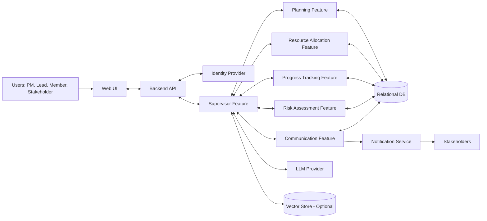

# Project 15 Architecture Diagram Specification

## Objective
This document defines a clear, presentation-ready architecture for Project 15: The AI Project Manager. Use this as the source for your final architecture diagram slide.

## 1. High-Level System View
The solution is an orchestrated multi-feature AI system with a Supervisor Feature at the center.

Core flow:
1. User provides project goal and constraints.
2. Supervisor Feature decomposes the goal and coordinates specialized features.
3. Features generate plan, allocate resources, track progress, assess risks, and produce communication outputs.
4. Results are stored and surfaced through dashboard and reports.

## 2. Architecture Layers

### 2.1 Presentation Layer
- Web UI (React or Next.js)
- Views:
  - Project Goal Intake
  - Plan Board (tasks, milestones, dependencies)
  - Team Capacity and Allocation
  - Risk Dashboard
  - Status Reports
- Optional manager notification panel

### 2.2 Application and Orchestration Layer
- API Backend (FastAPI/Node.js)
- Supervisor Feature (central orchestrator)
- Workflow engine (LangGraph/LangChain/N8N)
- Rules engine for governance constraints (due date policies, escalation thresholds)

### 2.3 AI Feature Layer
- Planning Feature
  - Input: project goal, constraints
  - Output: structured plan with milestones and dependencies
- Resource Allocation Feature
  - Input: plan, skill matrix, availability
  - Output: task-to-resource mapping
- Progress Tracking Feature
  - Input: task updates, timeline baseline
  - Output: status deltas and forecast variance
- Risk Assessment Feature
  - Input: current plan and progress
  - Output: risk register entries, severity, mitigation suggestions
- Communication Feature
  - Input: latest project state
  - Output: stakeholder updates, alerts, periodic reports

### 2.4 Data Layer
- Relational Database (PostgreSQL/Supabase)
  - projects
  - tasks
  - dependencies
  - resources
  - allocations
  - progress_logs
  - risks
  - reports
  - notifications
- Vector Store (optional)
  - project history embeddings
  - lessons learned retrieval
- Cache (Redis optional)
  - recent dashboard snapshots
  - transient orchestration state

### 2.5 External Integrations Layer
- LLM Provider API (OpenAI/Azure/Open-source endpoint)
- Communication APIs (Email, Slack, Teams)
- Calendar API (optional) for timeline and reminders
- Identity Provider (SSO) for role-based access

## 3. Key Data Flows for Diagram

### Flow A: Goal to Plan
- User submits goal through UI
- Backend validates and sends to Supervisor Feature
- Supervisor invokes Planning Feature
- Plan saved to database
- UI displays generated plan

### Flow B: Allocation
- Supervisor invokes Resource Allocation Feature using plan + team data
- Allocation output saved
- Allocation board updated in UI

### Flow C: Monitoring and Risk
- Progress updates received from users or integrations
- Progress Tracking Feature computes delays/slippage
- Risk Assessment Feature evaluates impact and mitigation options
- Risk register and alerts updated

### Flow D: Communication
- Communication Feature generates daily/weekly reports
- Reports stored and pushed to stakeholders via selected channel

## 4. Security and Governance Controls
- Role-based access control across all modules
- Audit log for plan changes, allocations, overrides, and risk decisions
- Manual approval gate for critical AI recommendations
- Encryption in transit and at rest

## 5. Diagram Components to Draw
Use these as labeled blocks:
- User Roles: PM, Team Lead, Team Member, Stakeholder
- Frontend UI
- Backend API
- Supervisor Feature
- Five Specialized Features
- Rules Engine
- Relational DB
- Vector Store (optional)
- Notification Service
- LLM Provider
- External APIs (Email/Slack/Calendar/SSO)

## 6. Diagram Arrows (Minimum)
- User Roles -> Frontend UI
- Frontend UI <-> Backend API
- Backend API <-> Supervisor Feature
- Supervisor Feature <-> Planning Feature
- Supervisor Feature <-> Resource Allocation Feature
- Supervisor Feature <-> Progress Tracking Feature
- Supervisor Feature <-> Risk Assessment Feature
- Supervisor Feature <-> Communication Feature
- Features <-> Database
- Supervisor Feature <-> LLM Provider
- Communication Feature -> Notification Service -> Stakeholders
- Backend API <-> SSO

## 7. Mermaid Draft (Optional)

## 8. Presentation Notes
- Keep the final architecture to one slide.
- Color-code by layer: UI, orchestration, AI features, data, external services.
- Highlight Supervisor Feature visually as the control center.
- Add a small legend for synchronous versus asynchronous flows.
