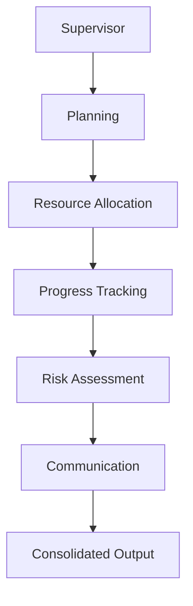

# LangGraph Workflow (Phase 4)

This workflow orchestrates the AI Project Manager execution pipeline.

## Node Sequence
1. Supervisor (entry)
2. Planning
3. Resource Allocation
4. Progress Tracking
5. Risk Assessment
6. Communication
7. Return consolidated dashboard payload

## Mermaid

## Runtime Integration
- Workflow module: `backend/app/workflows/project_workflow.py`
- Supervisor service call: `backend/app/services/supervisor.py`
- Agent implementations: `backend/app/agents/*.py`
- Execution output:
  - `task_count`
  - `risk_count`
  - `completion_percent`
  - `report_id`
